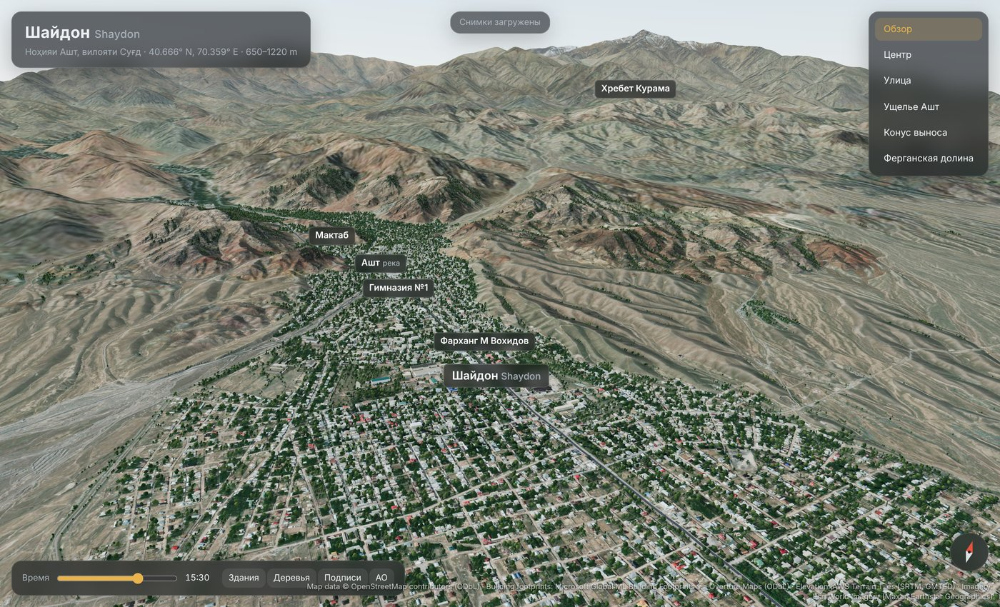
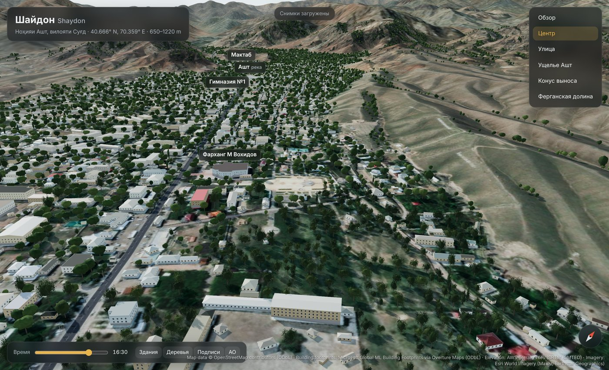
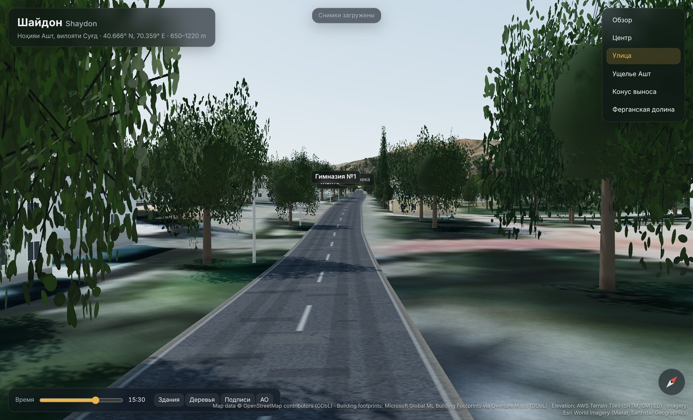
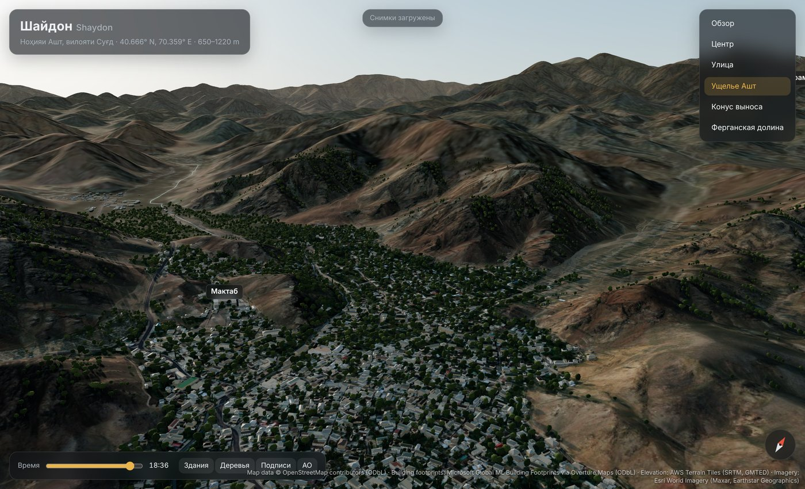

# 3D models of Shaydon and Khujand

An interactive, browser-based 3D model of **Shaydon** (Шайдон), the district
centre of Ashti district, Sughd region, Tajikistan (40.666° N, 70.359° E). The
town sits where the Ashtsoy river leaves the Kurama range for the Fergana valley.



| Centre | Street level | Ashtsoy gorge at sunset |
|---|---|---|
|  |  |  |

The same viewer and data pipeline also builds **Khujand** (Хуҷанд), the
regional capital on the Syr Darya: 65,518 buildings (≈17k from OpenStreetMap,
the rest Microsoft ML footprints), 135,300 trees, the river as water polygons,
Soviet-era apartment blocks and the Mogoltau mountains. Open it with
`index.html?city=khujand`.

Everything is placed from real map data, nothing is hand-placed:

| Layer | Source | How it is used |
|---|---|---|
| Relief | AWS Terrain Tiles (SRTM / GMTED) | 10 m grid over the town (6.2 × 5.8 km), 60 m grid over 52 × 47 km of mountains and valley |
| Ground | Esri World Imagery | streamed live in the browser and draped over the relief, refined to ~0.9 m/px near the camera |
| Buildings | Microsoft Global ML Building Footprints (via Overture Maps), plus extra roofs detected in the imagery | 6,743 footprints extruded with hip / gable / shed / flat roofs; roof colours sampled from the aerial imagery |
| Trees | detected in the aerial imagery (canopy segmentation) | 30,702 trees at their real positions; poplars along streets and ditches, broadleaf fruit trees, large chinars |
| Streets, canals, river, schools, culture palace | OpenStreetMap | asphalt main road, irrigation canals, Ashtsoy stream, labels |

Building heights come from OpenStreetMap where it has them (≈2,000 buildings in
Khujand). Elsewhere they are estimated from footprint size and shape: most
private houses are single storey, and in Khujand long rectangles 10–16 m deep
are treated as 3–9 storey apartment blocks.

## Viewing

The page loads its data with `fetch`, so it must be served over HTTP:

```sh
cd shaydon-3d
python3 -m http.server 8000
# open http://localhost:8000/
```

It also works on any static host (for example GitHub Pages). Three.js is loaded
from jsDelivr and the imagery from Esri, so the browser needs internet access.

Controls: left drag to pan, right drag to rotate, wheel to zoom, double-click to
fly to a point. The buttons on the right jump to preset views; the slider sets
the time of day (real sun position for Shaydon in June). URL parameters:
`?city=shaydon|khujand`, `&view=<id>` (a preset view from `tools/cities.json`),
`&t=18.5` (hour), `&noao` (disable ambient occlusion on slow GPUs).

## Rebuilding the data

```sh
cd shaydon-3d/tools
pip install numpy opencv-python-headless shapely pyarrow
export CITY=khujand                             # or shaydon; areas live in cities.json
python3 fetch_data.py /tmp/cache-$CITY          # OSM, elevation, imagery for analysis
python3 fetch_buildings.py /tmp/cache-$CITY     # Overture building footprints
python3 build_data.py /tmp/cache-$CITY          # writes ../data/$CITY/
python3 bake_imagery.py /tmp/cache-$CITY OUT    # optional: imagery for sandboxed hosts
```

`cities.json` holds each city's area, coordinate origin, preset views and
labels. `geo.py` defines the coordinate system (Web-Mercator metres scaled by
cos(lat₀), origin at the town centre) shared with the viewer. To add a city,
add an entry there and run the steps above.

## Files

- `index.html`: page, UI and import map
- `src/main.js`: renderer, sky and sun, shadows, ambient occlusion, camera views
- `src/terrain.js`: chunked terrain with progressive aerial imagery
- `src/buildings.js`: building geometry and procedural facades
- `src/trees.js`: instanced trees with leaf-card crowns and three levels of detail
- `src/features.js`: roads, water, utility poles
- `data/<city>/`: generated assets (`city.json`, `trees.bin`, terrarium-encoded elevation PNGs)

## Attribution

Map data © OpenStreetMap contributors (ODbL). Building footprints: Microsoft
Global ML Building Footprints via Overture Maps (ODbL). Elevation: AWS Terrain
Tiles (SRTM, GMTED). Imagery: Esri World Imagery (Maxar, Earthstar Geographics).
